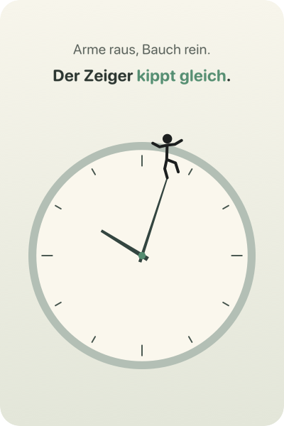
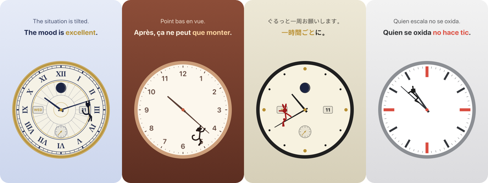
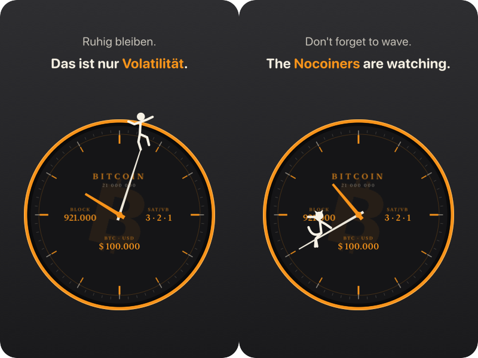

# Fun Watch — Zeigerreiter

Eine Schreibtischuhr für den Mac. Eine kleine Figur lebt auf dem Minutenzeiger, turnt mit ihm durch die Stunde und kommentiert, was ihr dabei passiert.

*A macOS desktop clock with a little figure living on the minute hand. It balances, hangs, slips and climbs as the hour goes by, with a new line every hour in twelve languages — and a Bitcoin mode with block height, fees and price from mempool.space.*

<p align="center"></p>

Ein privates Hobbyprojekt, kein Produkt: kein Geschäftsmodell, kein Support-Versprechen. Mehr dazu, mit Bildern, auf **[librarycompass.com/fun-watch](https://librarycompass.com/fun-watch/)**.
Eigenständige App, getrennt von der [Bitcoin-Uhr](https://github.com/JoeMartinBTC/Bitcoin_clock), nach demselben Muster gebaut (Swift Package Manager, kein Xcode-Projekt). Voraussetzung: macOS 14 oder neuer und die Swift-Toolchain.

<p align="center"></p>
<p align="center"></p>

## Was die Figur tut

Die Stellung des Minutenzeigers bestimmt die Bewegung:

| Minute | Bewegung | Hintergrund |
|---|---|---|
| 0–7 | balanciert auf der Zeigerspitze | hell |
| 7–18 | hängt am Zeiger und schwingt | hell |
| 18–27 | hängt an einer Hand und rutscht | dunkel |
| 27–34 | stemmt sich gegen den Zeiger | dunkel |
| 34–49 | sitzt auf dem Zeiger und winkt | hell |
| 49–60 | klettert zur Spitze | hell |

## Sprüche

Jede Bewegung hat zwölf Sprüche, zusammen 72. Jede Stunde zeigt je Bewegung einen anderen Spruch.
Je zwölf Stunden kommt jeder Spruch genau einmal, in zufälliger Reihenfolge.
Derselbe Spruch kommt nie zweimal direkt nacheinander, auch nicht über die Blockgrenze.
Die Reihenfolge hängt fest an der Stunde; nach einem Neustart steht derselbe Spruch da.

Die Sprüche gibt es in zwölf Sprachen (de, en, fr, es, it, pt, nl, tr, zh, ja, ko, hi), verteilt auf `Sprueche*.swift`. `*…*` markiert das farbige Wort.
Das Menü folgt der gewählten Sprache (`Menue.swift`, `MenueTexteWelt.swift`).
Die Übersetzungen sind frei übertragen und nicht von Muttersprachlern geprüft.

## Bitcoin-Modus

Oberster Menüpunkt. Das Blatt folgt der Bitcoin-Uhr: dunkel, Lünette in Orange, links Blockhöhe, rechts sat/vB, unten Kurs in USD.
Die Daten kommen alle fünf Minuten von mempool.space, nur bei eingeschaltetem Modus.
Die Figur spricht dann eigene Bitcoin-Sprüche, 72 je Sprache; englische Szenewörter (HODL, Stacking, Difficulty, number go up) bleiben englisch.
Farbe, Zifferblatt und Komplikationen sind im Bitcoin-Modus gesperrt.

## Varianten

| Was | Auswahl |
|---|---|
| Figur | Strichmännchen, Katze, Affe, Hase, Roboter |
| Farbe | Salbei, Bitcoin, Nacht, Sand, Westminster, Schiefer |
| Zifferblatt | Schlicht, Punkte, Ziffern, Balken, Big Ben |
| Komplikationen | Datum, Wochentag, Mondphase, kleine Sekunde |

Figur, Farbe und Zifferblatt können jede Stunde wechseln, nie dasselbe direkt nacheinander.

## Bedienung

- Linke Maustaste zieht die Uhr.
- Rechtsklick öffnet das Menü: Bitcoin-Modus, Größe, Figur, Farbe, Zifferblatt, Sprache, Komplikationen, Vorführung (eine Stunde in 40 Sekunden), „Über allen Fenstern“, „Beim Anmelden starten“, Beenden.

## Bauen und prüfen

```bash
bash Scripts/build_local_app.sh                      # baut, prüft, installiert, startet
Zeigerreiter --selbsttest                            # Ausgabe: ok
Zeigerreiter --folge 24                              # Spruchnummern der nächsten 24 Stunden
Zeigerreiter --bogen bogen.png 10:05:0 10:12:1       # Standbilder ohne Bildschirmaufnahme (Stunde:Minute:Haltung)
```

## Aufbau

| Datei | Inhalt |
|---|---|
| `Texte.swift` | Bewegungen, Auswahl je Stunde, Selbsttest |
| `Sprueche.swift` | 72 Sprüche je Sprache |
| `Aussehen.swift` | Farbwelten, Zifferblätter, Gestalten, Sprachen, Zufallsfolge |
| `Figur.swift` | Haltungen der Figur als Gelenkpunkte |
| `UhrView.swift` | Ebenen der Uhr; die Dauerbewegung läuft als Core-Animation |
| `AppDelegate.swift` | Fenster, Menü, Takt alle zehn Sekunden, Vorführung |
| `main.swift` | Start und die Prüfbefehle |
| `BitcoinDaten.swift` | Blockhöhe, Gebühren und Kurs von mempool.space, nur im Bitcoin-Modus |
| `Menue.swift`, `MenueTexteWelt.swift` | Menütexte in zwölf Sprachen |

## Mitmachen

Neue Figuren, Zifferblätter, Sprüche oder bessere Übersetzungen sind willkommen, als Pull Request oder Issue. Vor jedem Pull Request muss `Zeigerreiter --selbsttest` `ok` ausgeben.

## Lizenz

MIT, siehe `LICENSE`.
