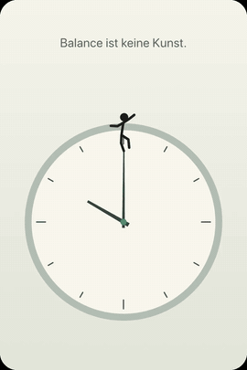
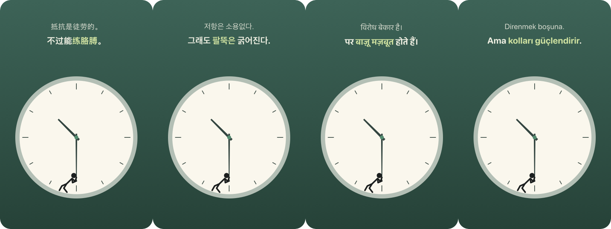

# Fun Watch — Zeigerreiter

Eine Schreibtischuhr für den Mac. Eine kleine Figur lebt auf dem Minutenzeiger, turnt mit ihm durch die Stunde und kommentiert, was ihr dabei passiert.

*A macOS desktop clock with a little figure living on the minute hand. It balances, hangs, slips and climbs as the hour goes by, with a new line every hour in twelve languages — and a Bitcoin mode with block height, fees and price from mempool.space.*

<p align="center"></p>
<p align="center"><sub>Vorführung aus dem Menü: eine Stunde in 40 Sekunden ·
<a href="docs/vorfuehrung-de.mp4">Video Deutsch (MP4)</a> ·
<a href="docs/vorfuehrung-en.mp4">Video English (MP4)</a> ·
<a href="https://librarycompass.com/fun-watch/">Projektseite</a></sub></p>

Ein privates Hobbyprojekt, kein Produkt: kein Geschäftsmodell, kein Support-Versprechen. Mehr dazu, mit Bildern und dem Film, auf **[librarycompass.com/fun-watch](https://librarycompass.com/fun-watch/)**.
Eigenständige App, getrennt von der [Bitcoin-Uhr](https://github.com/JoeMartinBTC/Bitcoin_clock), nach demselben Muster gebaut: Swift Package Manager, kein Xcode-Projekt, keine Abhängigkeiten außer AppKit und Core Animation.

<p align="center"></p>
<p align="center"></p>

## Inhalt

- [Was die Figur tut](#was-die-figur-tut)
- [Sprüche](#sprüche)
- [Sprachen](#sprachen)
- [Bitcoin-Modus](#bitcoin-modus)
- [Varianten](#varianten)
- [Bedienung](#bedienung)
- [Installieren](#installieren)
- [Prüfbefehle](#prüfbefehle)
- [Standbilder und Film](#standbilder-und-film)
- [Aufbau](#aufbau)
- [Technik](#technik)
- [Einstellungen](#einstellungen)
- [Mitmachen](#mitmachen)

## Was die Figur tut

Die Stellung des Minutenzeigers bestimmt die Bewegung:

| Minute | Bewegung | Hintergrund |
|---|---|---|
| 0–7 | balanciert auf der Zeigerspitze | hell |
| 7–18 | hängt am Zeiger und schwingt | hell |
| 18–27 | hängt an einer Hand und rutscht | dunkel |
| 27–34 | stemmt sich gegen den Zeiger | dunkel |
| 34–49 | sitzt auf dem Zeiger und winkt | hell |
| 49–60 | klettert zur Spitze | hell |

Zwischen zwei Bewegungen geht die Figur fließend von einer Haltung in die nächste über.
Innerhalb einer Bewegung läuft eine Dauerbewegung (Schwingen, Zappeln, Winken) als Core-Animation. Die App rechnet dafür nicht jedes Bild mit, sondern stellt die Uhr alle zehn Sekunden.

## Sprüche

Über der Uhr stehen zwei Zeilen: oben ruhig, unten fett mit einem farbigen Wort.
Die zweite Zeile erscheint erst eine Minute nach Beginn einer Bewegung, wie eine Pointe.

- Jede Bewegung hat zwölf Sprüche, zusammen 72 je Sprache.
- Jede Stunde zeigt je Bewegung einen anderen Spruch.
- Je zwölf Stunden kommt jeder Spruch genau einmal, in zufälliger Reihenfolge.
- Derselbe Spruch kommt nie zweimal direkt nacheinander, auch nicht über die Grenze zwischen zwei Zwölferblöcken.
- Die Reihenfolge hängt fest an der Stunde seit 1970. Nach einem Neustart steht derselbe Spruch da; Zeitzone und Sommerzeit ändern nichts daran.

Format in den Quellen: je Zeile `oben|unten`, `*…*` markiert das farbige Wort.

## Sprachen

Zwölf Sprachen, für Sprüche und Menü:

| Code | Sprache | Code | Sprache |
|---|---|---|---|
| de | Deutsch | nl | Nederlands |
| en | English | tr | Türkçe |
| fr | Français | zh | 中文 (vereinfacht) |
| es | Español | ja | 日本語 |
| it | Italiano | ko | 한국어 |
| pt | Português | hi | हिन्दी |

Die Übersetzungen sind frei übertragen und nicht von Muttersprachlern geprüft. Verbesserungen sind willkommen.

<p align="center"></p>

## Bitcoin-Modus

Oberster Menüpunkt („₿ Bitcoin-Modus“). Das Blatt folgt der [Bitcoin-Uhr](https://github.com/JoeMartinBTC/Bitcoin_clock): dunkle Karte, Lünette in Orange, ein großes ₿ im Hintergrund.

| Platz | Wert | Quelle |
|---|---|---|
| links | Blockhöhe | `https://mempool.space/api/blocks/tip/height` |
| rechts | Gebühren in sat/vB: schnell · halbe Stunde · Stunde | `https://mempool.space/api/v1/fees/recommended` |
| unten | Kurs in USD | `https://mempool.space/api/v1/prices` |

- Die App fragt alle fünf Minuten ab, nur bei eingeschaltetem Modus. Ohne Bitcoin-Modus gibt es keinen Netzverkehr.
- Vor der ersten Antwort steht „–“. Scheitert eine spätere Abfrage, bleibt der letzte gute Wert stehen.
- Die Figur spricht dann eigene Bitcoin-Sprüche, wieder 72 je Sprache. Szenewörter wie HODL, Stacking, Difficulty, Nocoiner und „number go up“ bleiben auch im Deutschen englisch.
- In Chinesisch steht Grün und in Koreanisch Blau für fallende Kurse, wie an den dortigen Börsen.
- Farbe, Zifferblatt und Komplikationen sind im Bitcoin-Modus gesperrt; die Figur wählt man weiter frei.

## Varianten

| Was | Auswahl |
|---|---|
| Figur | Strichmännchen, Katze, Affe, Hase, Roboter |
| Farbe | Salbei, Bitcoin, Nacht, Sand, Westminster, Schiefer |
| Zifferblatt | Schlicht, Punkte, Ziffern, Balken, Big Ben |
| Komplikationen | Datum, Wochentag, Mondphase, kleine Sekunde |
| Größe | Klein, Mittel, Groß, Sehr groß |

„Jede Stunde wechseln“ wählt Figur, Farbe und Zifferblatt jede Stunde neu, nie dasselbe direkt nacheinander.

## Bedienung

- Die linke Maustaste zieht die Uhr an einen anderen Platz.
- Rechtsklick öffnet das Menü:
  - ₿ Bitcoin-Modus
  - Größe, Figur, Farbe, Zifferblatt, Komplikationen, Sprache
  - Jede Stunde wechseln
  - Vorführung: eine Stunde in 40 Sekunden, danach wieder die echte Zeit
  - Über allen Fenstern (sonst liegt die Uhr auf dem Schreibtisch hinter den Fenstern)
  - Beim Anmelden starten
  - Beenden

Die App hat kein Dock-Symbol und keinen Eintrag in der Menüleiste.

## Installieren

Voraussetzung: macOS 14 oder neuer und die Swift-Toolchain (Xcode oder die Command Line Tools).

```bash
git clone https://github.com/JoeMartinBTC/fun_watch.git
cd fun_watch
bash Scripts/build_local_app.sh
```

Das Skript arbeitet in fünf Schritten: Release-Build, Selbsttest, App-Bundle, Ad-hoc-Signatur, Installation nach `/Applications` mit Start.
Die App ist nicht notarisiert. Sie läuft auf dem Mac, auf dem sie gebaut wurde; eine weitergegebene Kopie blockiert Gatekeeper.

Die App heißt im Programme-Ordner und im Dock „Fun Watch“; das Programm darin heißt weiter `Zeigerreiter`, die Bundle-ID bleibt `com.joemartinbtc.Zeigerreiter`.
Ein älteres `/Applications/Zeigerreiter.app` ersetzt das Skript automatisch; die Einstellungen bleiben erhalten.

Entfernen: App beenden, `/Applications/Fun Watch.app` löschen, auf Wunsch `defaults delete com.joemartinbtc.Zeigerreiter`.

## Prüfbefehle

```bash
Zeigerreiter --selbsttest   # Ausgabe: ok
Zeigerreiter --folge 24     # Spruchnummern je Bewegung für die nächsten 24 Stunden
```

Der Selbsttest prüft je Sprache: 72 allgemeine und 72 Bitcoin-Sprüche, genau einen Trenner `|` je Zeile, genau zwei `*` in der unteren Zeile, keine Dubletten, 32 Menüeinträge.
Dazu prüft er über 800 Tage die Folgen für Sprüche, Farbe, Zifferblatt und Figur: nie dasselbe direkt nacheinander, jeder Eintrag gleich oft.

Nach der Installation liegt der Befehl unter `"/Applications/Fun Watch.app/Contents/MacOS/Zeigerreiter"`.

## Standbilder und Film

Beide Befehle malen die Ebenen direkt in eine Bitmap, ohne Bildschirmaufnahme und ohne Fenster.

```bash
# Standbilder nebeneinander, je Zelle HH:mm[:haltung[:farbe[:blatt[:figur[:sprache[:k|btc]]]]]]
Zeigerreiter --bogen bogen.png 10:03:0.4:salbei:schlicht:mensch:de 10:40:0.7:::katze:en:btc

# Vorführung als 1200 PNG-Bilder (40 s, 30 Bilder je Sekunde, 800 × 1200)
Zeigerreiter --film bilder/ salbei:schlicht:mensch:de

# daraus das Video
ffmpeg -framerate 30 -i bilder/%04d.png -c:v libx264 -crf 28 -preset slow -pix_fmt yuv420p -movflags +faststart -an film.mp4

# und das GIF für diese README (270 px, 12 Bilder je Sekunde, 64 Farben)
ffmpeg -i film.mp4 -vf "fps=12,scale=270:-1:flags=lanczos,split[a][b];[a]palettegen=max_colors=64:stats_mode=diff[p];[b][p]paletteuse=dither=bayer:bayer_scale=4:diff_mode=rectangle" film.gif
```

- `haltung` ist der Stand der Dauerbewegung zwischen 0 und 1.
- `k` schaltet die Komplikationen ein, `btc` den Bitcoin-Modus mit festen Beispielwerten (921.000 · 3 · 2 · 1 · $ 100.000).
- Der Film nutzt dieselbe Rechnung wie die Vorführung im Menü, dazu eine feste Stunde und eine feste Spruchfolge. Er ist deshalb wiederholbar.
- Die Kartenecken sind durchsichtig und werden im Video schwarz. Wer den Film einbettet, rundet die Ecken per CSS: `border-radius: 7% / 4.667%`.
- H.264 mit `-crf 28` ergab rund 380 KB, VP9 mit `-crf 36` 636 KB.

Alle Bilder und Videos in `docs/` sind so entstanden.

## Aufbau

| Datei | Inhalt |
|---|---|
| `main.swift` | Start und die Befehle `--selbsttest`, `--folge`, `--bogen`, `--film` |
| `AppDelegate.swift` | Fenster, Menü, Takt alle zehn Sekunden, Vorführung, Autostart |
| `UhrView.swift` | Ebenen der Uhr: Karte, Blatt, Zeiger, Figur, Texte, Komplikationen, Bitcoin-Blatt |
| `Figur.swift` | Haltungen und Gestalten der Figur als Gelenkpunkte und Pfade |
| `Aussehen.swift` | Farbwelten, Zifferblätter, Gestalten, Sprachen, Wechsel je Stunde, Zufallsfolge |
| `Texte.swift` | Bewegungen, Auswahl je Stunde, Selbsttest |
| `Sprueche.swift`, `SpruecheAsien.swift` | allgemeine Sprüche, je Sprache 72 Zeilen |
| `SpruecheBitcoin*.swift` | Bitcoin-Sprüche, je Sprache 72 Zeilen |
| `Menue.swift`, `MenueTexteWelt.swift` | Menütexte in zwölf Sprachen |
| `BitcoinDaten.swift` | Abfrage bei mempool.space, nur im Bitcoin-Modus |
| `Scripts/build_local_app.sh` | bauen, prüfen, bündeln, signieren, installieren |
| `docs/` | Bilder, Videos und GIF dieser README |

## Technik

- **Fenster:** randlos und durchsichtig, auf Schreibtisch-Ebene oder über allen Fenstern. `LSUIElement`, also ohne Dock-Symbol.
- **Zeichnen:** Core-Animation-Ebenen in einer layer-hosting `NSView`. Die Figur besteht aus `CAShapeLayer`-Pfaden; zwischen zwei Haltungen animiert Core Animation den Pfad. Jede Gestalt hat deshalb eine feste Pfadstruktur.
- **Zufall ohne Wiederholung:** `Zufallsfolge` mischt je Block per Fisher-Yates mit SplitMix64, die Saat kommt aus Blocknummer und Salz. Beginnt ein Block mit dem letzten Eintrag des Blocks davor, tauschen Platz 0 und 1.
- **Last:** Die App stellt die Uhr alle zehn Sekunden; dazwischen arbeitet nur Core Animation. Gemessen rund 0,2 % CPU.
- **Netz:** nur im Bitcoin-Modus, drei öffentliche Abfragen alle fünf Minuten, ohne Schlüssel.

## Einstellungen

Gespeichert in den Benutzer-Einstellungen (`defaults read com.joemartinbtc.Zeigerreiter`):

| Schlüssel | Bedeutung |
|---|---|
| `breite` | Größe der Uhr |
| `gestalt`, `farbe`, `blatt`, `sprache` | gewählte Figur, Farbwelt, Zifferblatt, Sprache |
| `komplikationen`, `bitcoin`, `schwebend` | Schalter |
| `wechselGestalt`, `wechselFarbe`, `wechselBlatt` | Wechsel je Stunde |

## Mitmachen

Neue Figuren, Zifferblätter, Sprüche oder bessere Übersetzungen sind willkommen, als Pull Request oder Issue.
Vor jedem Pull Request muss `Zeigerreiter --selbsttest` `ok` ausgeben.

## Lizenz

MIT, siehe `LICENSE`.
